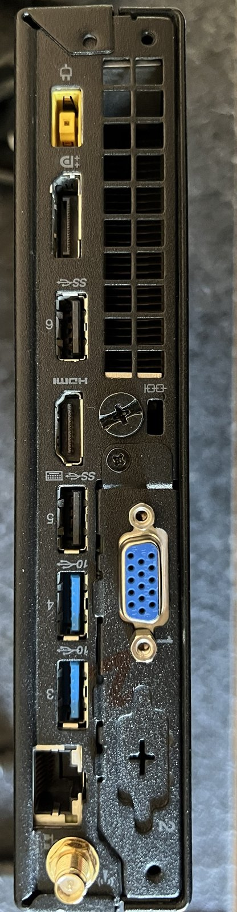
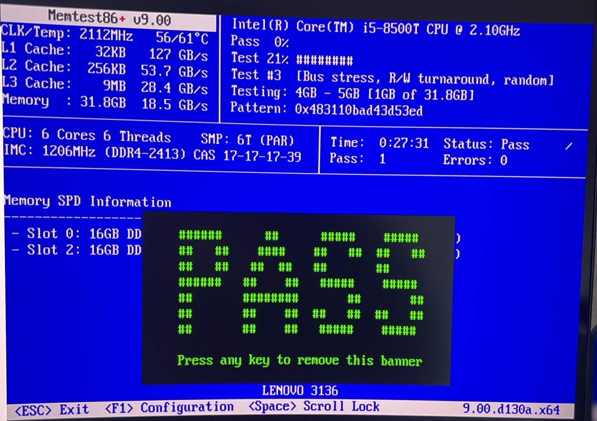
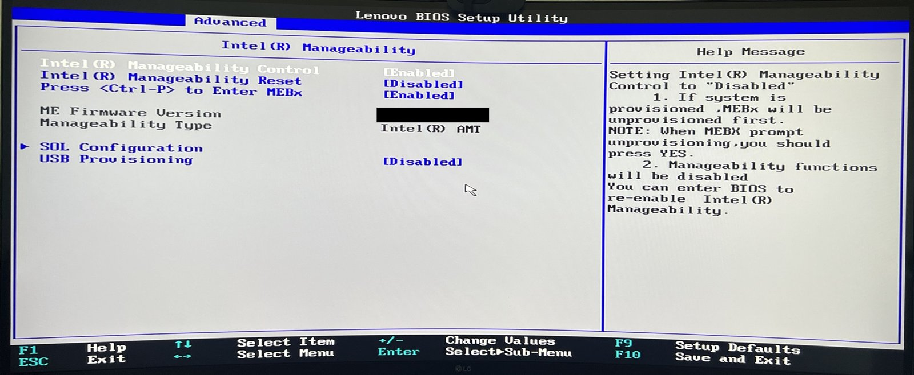
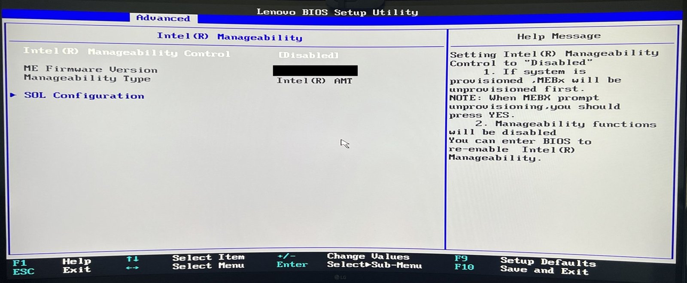
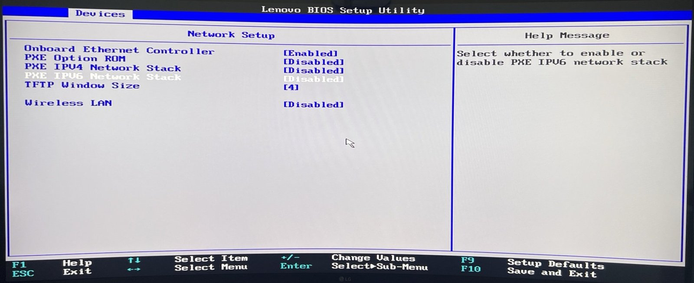
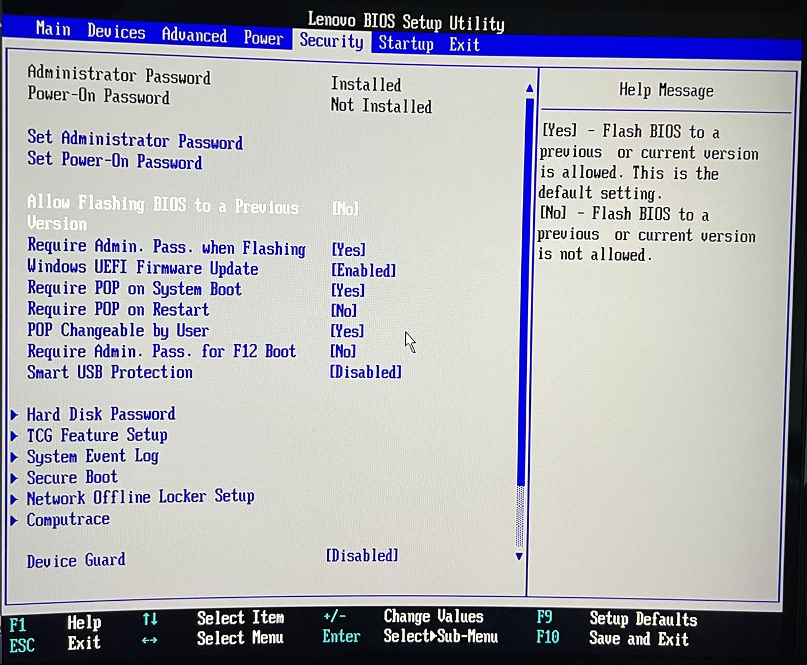
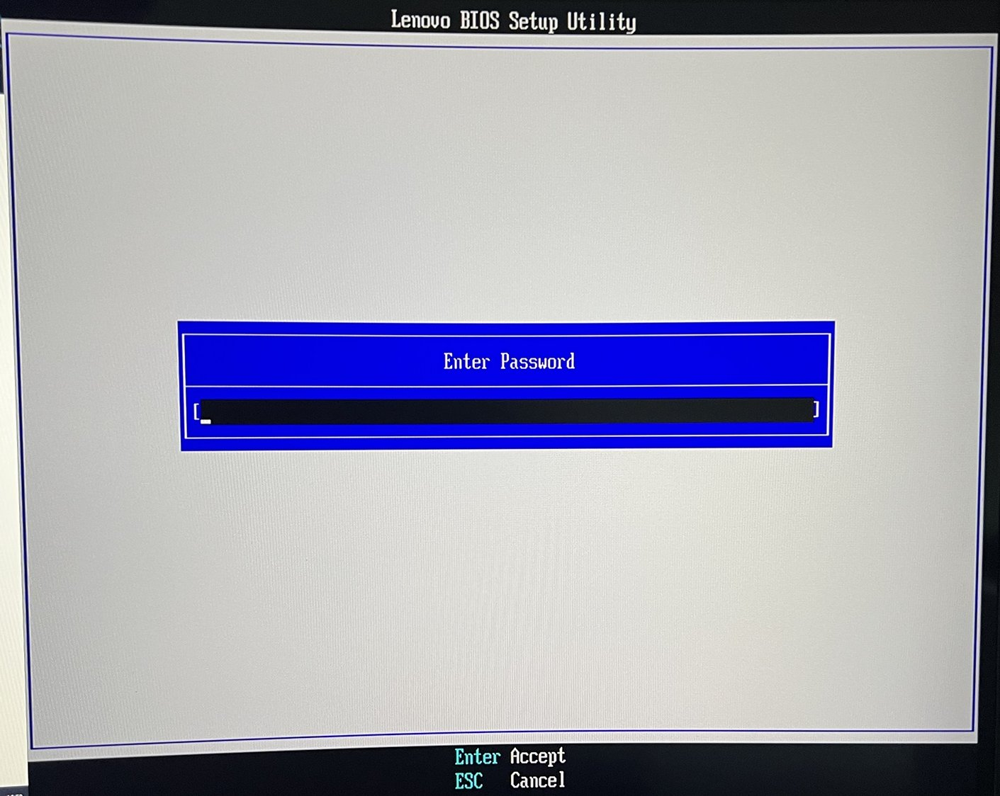

# ThinkCentre M920q – Hardware Intake and BIOS Security Baseline

**Project type:** Personal homelab · **Date:** October 2026 · **Status:** Complete (open follow-ups listed below)

> **Scope:** All testing and configuration work shown here was performed on personally owned equipment or isolated, authorised lab environments for educational purposes.
>
> This was a personal learning project on my own hardware. It is not production infrastructure. Serial numbers, device identifiers, credentials, network addresses and raw BIOS output have been removed.

---

## 1. Summary

I bought a used, refurbished mini PC to run as the virtualisation server in my homelab.

Before putting it into service, I checked three things:

1. **Is it what I paid for?** I compared the delivered hardware with the order.
2. **Is it healthy?** I tested the memory and the SSD.
3. **Is it safe to trust?** I reviewed every BIOS setting, removed remote-management features the previous corporate owner had enabled, and set a secure baseline for a server that must restart on its own.

Result: the hardware matched the order, passed all health tests, and now has a documented, verified security baseline with a rollback plan. One risk remains (the manufacturer no longer releases firmware updates for this model). I documented it, reduced it where possible and accepted it for a home lab.

---

## 2. Objective

- Confirm the refurbished device matches the purchased specification.
- Detect faulty RAM or a worn SSD **before** virtual machines and backups depend on them.
- Find and remove anything left behind by the previous owner (passwords, remote management, unusual boot settings).
- Prepare the firmware for a hypervisor: virtualisation support, unattended reboot, secure boot chain.
- Keep every change reversible and documented.

---

## 3. Environment and scope

| Item | Details |
|---|---|
| Device | Lenovo ThinkCentre M920q Tiny (refurbished, ex-corporate) |
| CPU / RAM | Intel Core i5-8500T (6 cores) / 32 GB DDR4 (2 × 16 GB, dual channel) |
| Storage | 512 GB NVMe SSD (Samsung PM981, OEM) |
| Network | 1 × Gigabit Ethernet (Intel I219-LM, vPro-capable) |
| Firmware | Lenovo UEFI BIOS, discrete TPM 2.0 |
| Planned role | Proxmox VE hypervisor for a personal FISI and security practice lab |
| Test tools | Memtest86+ v9.00 (booted from a Ventoy USB stick), smartctl (smartmontools 7.5) |

**In scope:** physical inspection, hardware verification, RAM and SSD health tests, BIOS/UEFI review and hardening, firmware version check, rollback planning.

**Out of scope:** hypervisor installation and configuration (Project 03), network segmentation (Project 04).

---

## 4. My work / implementation

### 4.1 Intake and physical check

- Checked the case for damage and clear vents (light cosmetic wear only).
- Confirmed the power supply is an original Lenovo unit with enough capacity (90 W; the model ships with 65 W or 90 W).
- Confirmed the machine type on the label matches the M920q. I did **not** record the serial number in my notes.
- Listed all ports and installed modules. Unexpected findings: an extra VGA module and a Wi-Fi card. The 2.5" SATA bay is empty (option for a second disk later).

*Rear panel: power, DisplayPort, HDMI, USB, Gigabit LAN, the extra VGA module and the Wi-Fi antenna connector.*

### 4.2 Expected vs. found

I read the system summary in the BIOS and compared it with the order.

| Component | Expected | Found | Result |
|---|---|---|---|
| CPU | i5-8500T, 6 cores | i5-8500T, 6 cores | ✅ Match |
| RAM | 32 GB DDR4 | 32 GB, 2 × 16 GB, dual channel | ✅ Match – runs at 2400 MHz instead of the CPU's maximum 2666 MHz because the modules are rated DDR4-2400. No practical impact for a lab. |
| SSD | 512 GB NVMe | 512 GB NVMe (Samsung PM981 OEM) with an old Windows installation | ✅ Match – old OS removed later by the hypervisor installation |
| Network | 1 × Gigabit LAN | Intel I219-LM | ✅ Match – "LM" means vPro-capable, so I added a remote-management check (4.4) |
| Extras | – | Wi-Fi card, VGA module | Not needed → Wi-Fi disabled in BIOS |

**Why this matters:** refurbished devices sometimes ship with swapped or smaller parts. A documented hardware inventory is also the first step of asset management (CIS Controls v8, safeguard 1.1).

### 4.3 Health testing

**Memory – Memtest86+**

- Booted Memtest86+ v9.00 from a Ventoy USB stick.
- Verified every downloaded tool with its published SHA-256 hash before use.
- Secure Boot was turned off only for this test (the Ventoy stick does not support Secure Boot), then turned back on and verified.
- **Result:** 1 full pass, **0 errors**, all 6 cores, about 32 GB tested in about 27 minutes. CPU temperature stayed at 56–61 °C under full load with no throttling.

**SSD – SMART/NVMe health data**

Run with `smartctl -a` after the hypervisor installation and **before** any virtual machines were created, followed by a short self-test (`smartctl -t short`, result read with `smartctl -l selftest`).

| Indicator | Result | Meaning |
|---|---|---|
| Overall health | PASSED | ✅ |
| Critical warning | None | ✅ |
| Available spare | 100 % | No reserve blocks used |
| Percentage used | 1 % | Almost no wear |
| Media and data integrity errors | 0 | No unrecoverable data errors |
| Power-on hours | approx. 6,000 h | Typical office use |
| Unsafe shutdowns | 129 | Power lost without shutdown in previous use – no damage visible |
| Error log entries | 246, all "Invalid Field in Command" | Unsupported admin commands sent by software, **not** media errors |
| Temperature history | No time above warning or critical temperature | ✅ |
| Short self-test | Completed without error | ✅ |

> No screenshot is published here: the raw `smartctl` output contains the SSD serial number.

**Why this matters:** faulty RAM or a failing SSD can silently corrupt virtual machines and backups. Testing before use protects availability and data integrity.

### 4.4 BIOS baseline review

Before changing anything, I photographed every BIOS page as a rollback reference and recorded the found state in a table.

Findings:

- No BIOS passwords were left behind.
- Boot mode was already UEFI-only (legacy/CSM off).
- Secure Boot and the TPM 2.0 chip were already enabled.
- Virtualisation features (VT-x, VT-d) were already enabled.
- Anti-theft tracking (Computrace/Absolute) was disabled and not activated.
- **Intel AMT remote management was enabled.** A previous company asset tag was still stored in the BIOS, which confirmed this was an ex-fleet device.
- Wi-Fi, network boot (PXE), Wake-on-LAN and onboard audio were enabled but not needed.

I decided **not** to load factory defaults first: the settings were sane and no passwords were set, so fewer changes meant an easier rollback.

*Found state: Intel AMT remote management enabled. (Firmware version redacted.)*

### 4.5 Hardening changes

| Setting | Before | After | Reason |
|---|---|---|---|
| BIOS administrator (supervisor) password | Not set | **Set** | Stops anyone with physical access from changing BIOS settings, for example disabling Secure Boot. (USB boot is still allowed for now – see section 10.) |
| Power-on password | Not set | **Not set** (deliberate) | A server must reboot unattended after updates or power loss |
| Require admin password for BIOS flashing | No | **Yes** | BIOS updates and re-flashing require the password |
| Allow flashing to a previous BIOS version | Yes | **No** (after the firmware check in 4.6) | Prevents downgrading to an older, vulnerable BIOS |
| Intel Manageability Control (AMT) | Enabled | **Disabled** | Removes remote management below the operating system that the previous owner may have configured |
| Wireless LAN | Enabled | **Disabled** | Not used; less attack surface, fewer drivers |
| PXE option ROM and UEFI IPv4/IPv6 network stacks | Enabled | **Disabled** | No network boot needed; in UEFI-only mode the PXE boot entries come from the UEFI stacks, so both had to be disabled |
| Wake-on-LAN | Automatic | **Disabled** | Runs 24/7, nothing to wake |
| Onboard audio | Enabled | **Disabled** | Not needed on a server |
| After power loss | Last state | **Power on** | Server comes back automatically after a power cut |

| After: Intel AMT disabled | After: network boot and Wi-Fi disabled |
|---|---|
|  |  |

*Security tab after hardening. "Require POP on System Boot" has no effect because no power-on password is set.*

**Kept unchanged on purpose:** UEFI-only boot, Secure Boot, TPM 2.0, VT-x and VT-d. Computrace was left disabled rather than *permanently* disabled, because that option cannot be undone.

> **Note on Intel AMT/ME:** disabling Manageability Control turns off the AMT remote-management feature. The Intel Management Engine firmware itself still exists on the board and cannot be removed.

### 4.6 Firmware lifecycle check

- Compared the installed BIOS version with the Lenovo support page for this machine type.
- The installed version is the **newest available release**. No flash was needed.
- Lenovo lists the model as **end of development support**, so this is also the **final** BIOS. Future firmware vulnerabilities will not be patched.

**Risk decision:**

| | |
|---|---|
| Risk | Unpatched future firmware or Management Engine vulnerabilities |
| Mitigations | AMT disabled; BIOS admin password set; downgrade blocked; CPU microcode updates delivered through the operating system instead (verified after installation in Project 03); hypervisor management interface never exposed to the internet |
| Decision | Risk accepted for a personal home lab |
| Review trigger | Re-evaluate if a critical BIOS/ME vulnerability is published for this model |

---

## 5. Key decisions and rationale

| Decision | Alternative considered | Why I chose this |
|---|---|---|
| Admin password, no power-on password | Both passwords | Physical-access protection without blocking unattended reboots |
| Disable AMT | Provision AMT with my own password | I don't need out-of-band management; turning it off removes the risk completely |
| Keep current settings instead of loading defaults | Reset to factory defaults | Sane starting state, no leftover passwords; fewer changes are easier to roll back |
| Computrace disabled, not permanently disabled | Permanent disable | The permanent option is irreversible; the admin password already stops re-enabling it |
| Block BIOS downgrades only after confirming the final version | Block immediately | Kept the option to flash an update until I knew none was needed. Side effect: re-flashing the same version now needs the setting changed back temporarily |
| Verify tool downloads by SHA-256 hash | Trust the browser download | A browser reputation warning is not an integrity check (see lessons learned) |

**Related frameworks:** BSI IT-Grundschutz (module SYS.1.1, general server) and CIS Controls v8 (1.1 asset inventory, 4.1 secure configuration process).

---

## 6. Validation and evidence

| Check | Result |
|---|---|
| Boot menu after disabling network boot | Lists only the internal SSD and BIOS setup – no PXE entries ✅ |
| Reboot with admin password set | System boots without a password; BIOS setup asks for the password ✅ |
| Stored admin password works | Accepted at the BIOS prompt ✅ (checked for keyboard-layout problems, since the BIOS uses a US layout) |
| Secure Boot after the memory test | Enabled again, deployed mode ✅ |
| System date and time | Correct ✅ (a wrong clock can break TLS and updates, or point to a weak CMOS battery) |
| Memory test | PASS, 0 errors ✅ |
| SSD health and short self-test | PASSED / completed without error ✅ |
| Hardware inventory | Recorded in the lab's hardware inventory ✅ |

| Boot menu after hardening | Password prompt when entering setup |
|---|---|
|  |  |

*Boot menu taken before the hypervisor installation, so it still shows the old Windows boot entry. SSD model redacted.*

### Rollback plan

| Situation | Rollback |
|---|---|
| A BIOS change causes problems | Restore the documented "before" values from the photos, or load optimal defaults |
| A downgrade or re-flash is needed | Temporarily set *Allow flashing to a previous version* back to **Yes** |
| Admin password lost | Hardware CMOS/password-clear procedure according to the Lenovo hardware manual (planned, not tested) |

---

## 7. Outcome

- Hardware confirmed as ordered, with one minor and documented difference (RAM speed).
- RAM and SSD passed health tests; the SSD shows almost no wear.
- Previous owner's remote-management feature disabled; no leftover passwords or tracking.
- Secure firmware baseline in place: admin password, protected flashing, UEFI-only, Secure Boot, TPM, unused interfaces off.
- Device restarts on its own after power loss and boots without a password.
- End-of-support firmware risk documented, mitigated and accepted.
- Every change logged with a reason and a rollback path.

The device was then ready for the hypervisor installation (Project 03).

---

## 8. Skills demonstrated

**System administration / IT support**
- Hardware verification and asset documentation
- RAM and SSD diagnostics (Memtest86+, SMART/NVMe data, `smartctl` self-test)
- UEFI/BIOS configuration for a virtualisation host (VT-x, VT-d, boot mode, power recovery)
- Firmware version and vendor lifecycle check
- Change documentation with before/after state and rollback

**Security / blue team**
- Attack-surface reduction (wireless, network boot, Wake-on-LAN, out-of-band management)
- Boot-chain protection (Secure Boot, TPM 2.0, BIOS admin password, flash and downgrade protection)
- Checking a second-hand device for previous-owner remote access
- File integrity verification with SHA-256
- Risk assessment: documenting, mitigating and accepting an end-of-support risk with a review trigger

**FISI exam topics touched:** IT systems and hardware selection, BIOS/UEFI, IT security (protection goals: confidentiality, integrity, availability), BSI IT-Grundschutz, technical documentation.

---

## 9. Lessons learned

- **A reputation warning is not an integrity check.** My first two Memtest86+ downloads were stopped by the browser because the release was new and rarely downloaded, leaving incomplete files. Checking the SHA-256 hash showed the problem (an empty file has a well-known hash). After allowing the download, the hash matched the official value.
- **Disabling PXE in UEFI mode needs more than the option ROM.** The boot entries only disappeared after I also disabled the UEFI IPv4/IPv6 network stacks. Checking the boot menu afterwards proved it.
- **Not every SMART error is a disk problem.** Hundreds of error-log entries looked worrying, but all were "invalid field in command" responses, not media errors.
- **Some options cannot be undone.** I checked for irreversible settings (such as permanent Computrace disable) before changing anything.
- **Practical detail:** on this model the setup key is easy to miss; the boot menu (F12 → Enter Setup) is a reliable alternative.

---

## 10. What I would improve next

- [ ] Restrict booting after installation: internal SSD first, USB boot disabled or protected by the admin password.
- [ ] Decide whether to require the admin password for the one-time boot menu.
- [ ] Decide on chassis intrusion detection (logs when the case is opened).
- [ ] Consider clearing the TPM once to remove any keys from the previous owner.
- [ ] Test the password-clear rollback procedure on paper against the hardware manual.
- [ ] Add a small UPS to reduce unsafe shutdowns.
- [ ] Check vendor security advisories for this model regularly, as defined in the risk decision.
- [ ] Later: add a second network port (PCIe riser and low-profile NIC) to physically separate the firewall's WAN side.

---

**Next project:** [02 – Home Network Security Baseline](../02-home-network-security-baseline/README.md) · [Back to overview](../../README.md)
