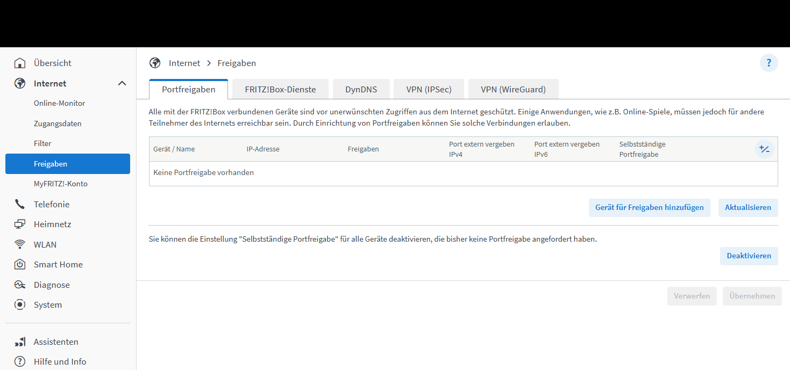
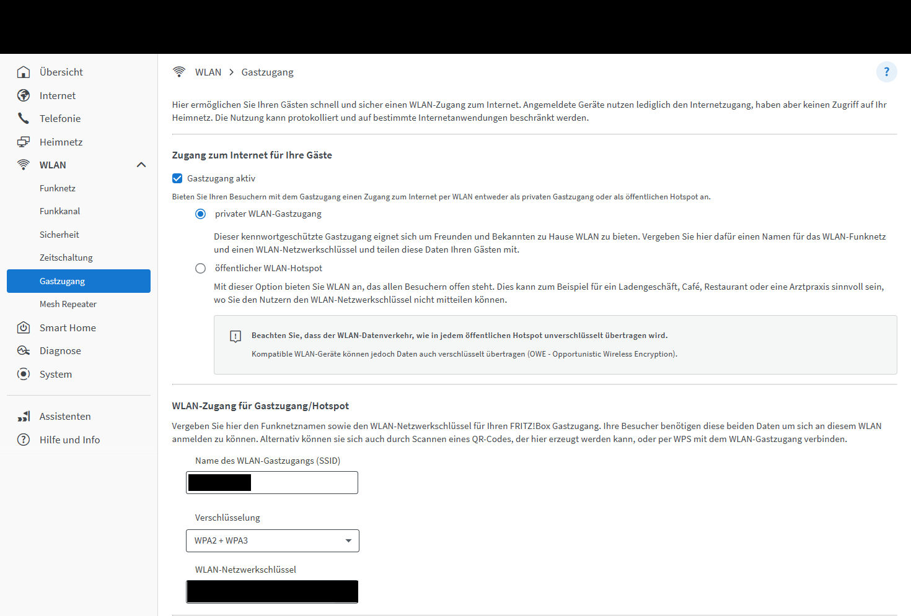
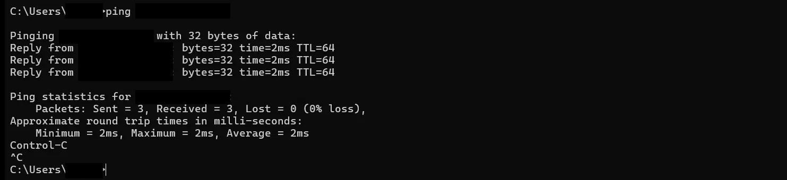
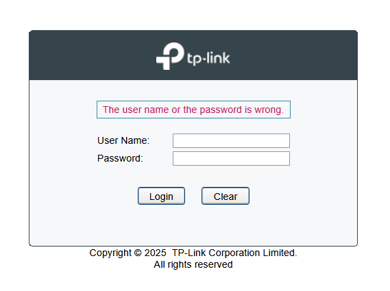

# Home Network Security Baseline – Router, Wi-Fi and Lab Switch

**Project type:** Personal homelab · **Date:** October 2026 · **Status:** Complete (open items tracked privately)

> **Scope:** All testing and configuration work shown here was performed on personally owned equipment or isolated, authorised lab environments for educational purposes.
>
> This project covers my own home network. Addresses, device names, usernames, provider details and any open weaknesses have been removed or generalised on purpose.

---

## 1. Summary

Before connecting a virtualisation lab, including intentionally vulnerable practice machines, to my home network, I made sure the network itself was secure.

I worked in two steps:

1. **Home router and Wi-Fi:** replaced the factory login, added two-factor confirmation, tightened Wi-Fi security, created an isolated guest network, closed automatic port openings and blocked phone-fraud risks.
2. **New lab switch:** replaced the factory password, gave it a fixed address and a recognisable name, saved a configuration backup and documented a protocol limitation with a mitigation.

Every change followed the same routine: **backup → one change → test → next change**. Each one is documented with a reason and a way to undo it.

---

## 2. Objective

- Remove default credentials and unnecessary access from network devices.
- Separate untrusted devices (guests, smart TVs and similar) from my own computers and the future lab.
- Make sure no device can open ports to the internet on its own.
- Prepare a managed switch as the foundation for VLAN segmentation later.
- Document every change with verification and rollback.

---

## 3. Environment and scope

| Item | Details |
|---|---|
| Router | Consumer router with firmware managed by the internet provider |
| Wi-Fi | Router plus one mesh repeater; a few household devices |
| Lab switch | TP-Link TL-SG108E (8-port Gigabit, 802.1Q VLAN support) |
| Admin workstation | Laptop on the wired home LAN |
| References | BSI guidance for home users (router, Wi-Fi), CIS Controls v8, NIST SP 800-63B (passwords) |

**In scope:** router administration, firmware status, Wi-Fi security, guest network, port forwarding and UPnP, telephony fraud settings, switch baseline.

**Out of scope:** VLAN implementation and firewalling between lab networks (Project 04).

---

## 4. My work / implementation

### 4.1 Preparation

- Created a **password-protected backup** of the router configuration before any change, stored outside synced folders.
- Worked through a checklist one item at a time, testing after each change.

### 4.2 Router administration

| Before | After | Why |
|---|---|---|
| Automatically created admin user with the password printed on the device sticker | **Own admin user** with a new passphrase | The sticker password can be read by anyone with physical access to the router |
| Admin user had access to network storage content | Storage access **removed** | Least privilege: the admin account only needs admin rights |
| No second factor | **Authenticator app** required to confirm security-critical changes | Stolen password alone is not enough |
| Admin interface over HTTP | **HTTPS**; self-signed certificate checked by comparing its fingerprint | Login no longer sent in clear text on the LAN |
| Internet access to the admin interface | **Off** | Router management only from inside the home network |

**Lockout prevention:** I tested the new login in a private browser window before logging out of the working session.

### 4.3 Firmware and lifecycle

- The router had no "update" menu. My hypothesis was that the provider manages it, which I confirmed in the provider services settings.
- Automatic provider updates were kept **on**. Turning them off would mean no updates at all.
- **Risk decision:** the provider patches the firmware, I own the configuration (shared responsibility). Accepted and documented.
- An older mesh device reported "version current" but is likely no longer receiving updates. **Current is not the same as supported.** Tracked for replacement.

### 4.4 Wi-Fi

| Setting | Result | Why |
|---|---|---|
| Encryption | WPA2 + WPA3 mixed mode | WPA3-only would break the older mesh device; mixed mode lets newer devices use WPA3 |
| WPS and push-button pairing | **Off** | Convenience features that let devices join without the key |
| Wi-Fi key | **Changed** from the default | Default keys are printed on the device and its packaging |

I did **not** rely on hiding the network name or MAC address filtering. Neither is a real security control: both can be bypassed with basic tools.

### 4.5 Guest network (first segmentation step)

- Created a **private guest Wi-Fi** with its own key, WPA2 + WPA3, and **client isolation**.
- Purpose: a compromised guest or smart device should not be able to reach my laptop, the router interface or the future lab host (lateral movement).

### 4.6 Port forwarding and UPnP

- **No port forwards** configured.
- **Automatic port forwarding (UPnP) disabled** for all devices, so malware on one device cannot open a port to the internet by itself (as botnets such as Mirai have exploited).

### 4.7 Telephony fraud protection

- The landline is not used, so I **blocked premium-rate and international calls**, and blocked internet telephony from devices in the home network.
- Emergency numbers were **not** blocked.
- Why: toll-fraud attacks against home routers have caused large phone bills in Germany in the past.

### 4.8 Lab switch baseline

| Change | Why | Related control |
|---|---|---|
| Found the switch with the vendor's discovery tool and in the router's device list | Know exactly which device I am configuring | Asset inventory |
| **Factory login replaced** with a strong password | Anyone on the network could otherwise reconfigure ports and VLANs | CIS Controls v8, 4.7 (default accounts) |
| **Descriptive name** set on the switch and in the router | Recognisable in every device list | CIS Controls v8, 1.1 (asset inventory) |
| **Fixed address** via a DHCP reservation in the router | Stable management address for later firewall rules | – |
| **UPnP off** for the switch | A management device should never open ports to the internet | BSI guidance |
| Firmware checked against the vendor site | Already current; re-check every few months | Patch management |
| **Configuration backup** exported and stored outside my notes | Quick restore after a mistake | – |

**Known limitation:** the switch's web interface only supports **HTTP**, so the admin password crosses the network unencrypted.

**Mitigation:** manage the switch only from my laptop on the wired home LAN, never from Wi-Fi or the guest network. Later, move management into a dedicated management VLAN (Project 04).

---

## 5. Key decisions and rationale

| Decision | Alternative | Why I chose this |
|---|---|---|
| Keep provider-managed firmware updates on | Disable provider management | Without it the router gets no updates at all |
| WPA2 + WPA3 mixed mode | WPA3 only | Compatibility with an older mesh device; replacing it is tracked |
| Guest Wi-Fi with client isolation now | Wait for full VLANs | Quick, effective separation of untrusted devices today |
| Accept HTTP-only switch management with a mitigation | Replace the switch | Affordable lab switch; risk limited by restricting where it is managed from |
| Backup → one change → test | Change everything at once | If something breaks, I know which change caused it |

---

## 6. Validation and evidence

| Check | Result |
|---|---|
| Router security report | No port forwards, no internet access to admin interface or storage, WPS off, no telephony warnings ✅ |
| Router login history | Only my own sessions ✅ |
| Guest network test (phone on guest Wi-Fi) | Internet works ✅; router admin interface **not** reachable ✅ |
| Switch reachability | Ping: 3/3 replies, 0 % loss ✅ |
| Switch login | New password works ✅ |
| Switch factory default login after the change | **Rejected** ✅ – default credentials no longer work |
| Router device list | Switch shows with permanent address and no port forwards ✅ |

*No port forwards configured. Router branding redacted.*

*Private guest Wi-Fi with WPA2 + WPA3. Network name and key redacted.*

*Switch reachability test. IP address and local username redacted.*

*Factory default login attempted after the change: rejected.*

### Rollback plan

| Component | Rollback |
|---|---|
| Router | Restore the password-protected configuration backup |
| Switch | Restore the exported configuration file; worst case factory reset, then restore |
| Switch address | Remove the DHCP reservation in the router |

---

## 7. Defender's view

| Weakness before | How it could be abused | Now |
|---|---|---|
| Sticker password on the router | A visitor or compromised device logs in, changes DNS or opens ports | Own user, passphrase, two-factor confirmation |
| UPnP automatic port forwarding | Malware on one device opens a port to the internet | Disabled |
| Flat network for all devices | A compromised smart TV scans and attacks laptops | Guest Wi-Fi with client isolation |
| Telephony open | Malware places premium-rate calls | Premium, international and LAN-based internet telephony blocked |
| Factory login on the switch | Anyone on the LAN reconfigures ports or VLANs | Own strong password |

---

## 8. Outcome

- Default credentials removed from router and switch.
- Router management protected by passphrase, two-factor confirmation, HTTPS and no internet access.
- Untrusted devices separated through an isolated guest network.
- No port forwards and no automatic port openings.
- Phone-fraud risk removed.
- Lab switch inventoried, backed up and ready for VLAN work.
- Remaining low-severity items are tracked in a private findings list with an owner decision for each (fix, replace or accept).

---

## 9. Skills demonstrated

**System administration / IT support**
- Router and switch administration
- DHCP reservations versus static addressing
- Configuration backup and restore planning
- Firmware and lifecycle checks, including provider-managed devices
- Change management: backup, one change, test, document

**Security / blue team**
- Removing default credentials; least privilege; two-factor authentication
- Wi-Fi security (WPA2/WPA3, WPS) and recognising ineffective "security" myths
- Network segmentation with client isolation to limit lateral movement
- Attack-surface reduction (UPnP, port forwarding, remote admin access)
- Identifying clear-text management protocols and planning a mitigation
- Writing findings with severity and status; documented risk acceptance

**FISI exam topics touched:** DHCP and IP addressing, managed versus unmanaged switches, preparation for 802.1Q VLANs, Wi-Fi security, network segmentation, patch and lifecycle management, risk management, IT security protection goals.

---

## 10. Lessons learned

- **Current is not the same as supported.** A device can show "up to date" and still be at the end of its update life.
- **The provider patches the firmware, I own the configuration.**
- **A documented risk acceptance is a valid decision**, as long as it has a reason and a review point.
- **A firewall only filters traffic that passes through it.** Devices on the same network segment need separation, which is why the guest network matters.
- **Check details exactly.** I initially noted the wrong router model and assumed a LAN port was the WAN port. Both were corrected by checking the device itself.
- **Certificate fingerprints:** my browser only showed SHA-256 fingerprints, while the router listed SHA-1, so I used Windows tools to compare the matching value.

---

## 11. What I would improve next

- [ ] Replace the older mesh device so the Wi-Fi can move to WPA3-only.
- [ ] Clean up and name all entries in the router's device list (asset inventory).
- [ ] Move remaining smart-home and entertainment devices to the guest network.
- [ ] Review the switch's unused features (port mirroring off, loop prevention on).
- [ ] Move switch management into a dedicated management VLAN, so the HTTP-only interface is reachable only from the admin network (Project 04).
- [ ] Capture the switch's HTTP login in a lab with Wireshark to show the clear-text risk in practice.

---

**Previous project:** [01 – ThinkCentre Intake and BIOS Baseline](../01-thinkcentre-intake-bios-baseline/README.md) · **Next project:** Proxmox VE Host Deployment *(in progress)* · [Back to overview](../../README.md)
