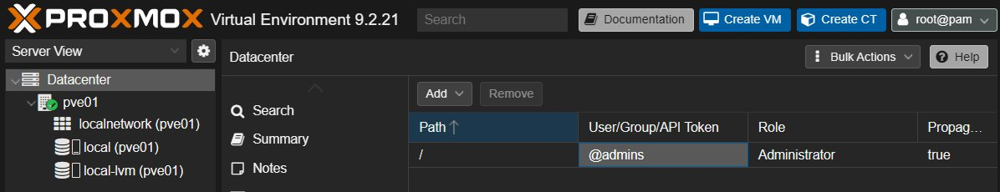
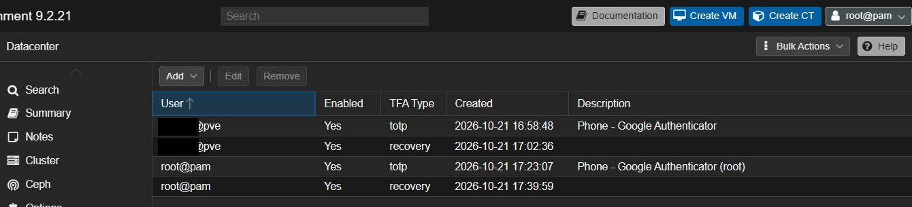
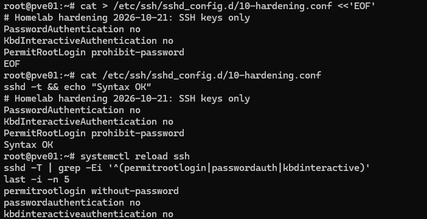
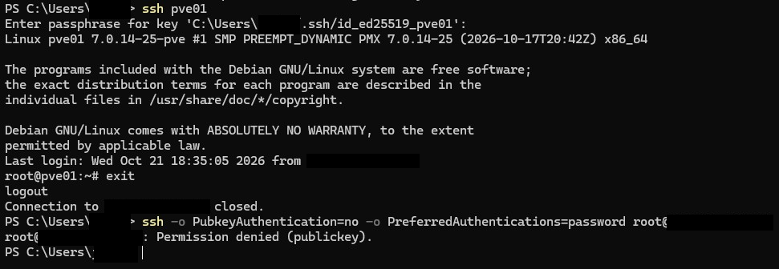

# Proxmox VE Host – Installation, Updates and Access Control

**Project type:** Personal homelab · **Date:** October 2026 · **Status:** Access-control baseline complete (firewall, management network and backups follow in the next steps)

> **Scope:** All testing and configuration work shown here was performed on personally owned equipment or isolated, authorised lab environments for educational purposes.
>
> This was a personal learning project on my own hardware. It is not production infrastructure. IP addresses, usernames, key material, fingerprints and recovery codes have been removed or blacked out.

---

## 1. Summary

After the hardware check and BIOS baseline ([Project 01](../01-thinkcentre-intake-bios-baseline/README.md)) and the home network baseline ([Project 02](../02-home-network-security-baseline/README.md)), I installed **Proxmox VE 9.2** on the ThinkCentre M920q and secured the ways to log in **before** creating any virtual machine.

I worked in five steps:

1. **Install and update:** signed installer, Secure Boot on, correct update repository, full upgrade, CPU microcode check.
2. **Least privilege:** a personal admin account instead of working as `root` every day.
3. **Second factor:** TOTP and recovery keys for both accounts that can log in to the web interface.
4. **SSH:** key-only login with a dedicated key, password login switched off and tested.
5. **Exposure check:** confirm that nothing on the host is reachable from the internet.

Result: the web interface needs a password **and** a one-time code, SSH needs a passphrase-protected private key, and a password login over SSH is refused. Every step has a verification and a rollback path.

---

## 2. Objective

- Install the hypervisor from a verified installer, with Secure Boot kept on.
- Get security updates, including CPU microcode, even though the BIOS of this model is end of support.
- Stop using `root` for daily work (least privilege, traceable actions).
- Protect every remote login path with something stronger than a password.
- Keep a break-glass path so that a mistake cannot lock me out.

---

## 3. Environment and scope

| Item | Details |
|---|---|
| Host | Lenovo ThinkCentre M920q (Project 01), hostname `pve01` |
| Hypervisor | Proxmox VE 9.2 (Debian 13 based), single node |
| Storage layout | One NVMe SSD, ext4 with LVM-thin |
| Network | Static address outside the router's DHCP range, wired |
| Admin workstation | Windows laptop with OpenSSH client and a browser |
| Authenticator | Authenticator app on the phone (separate from the password manager) |
| References | BSI IT-Grundschutz (ORP.4 identity and access management, SYS.1.5 virtualisation), CIS Controls v8 |

**In scope:** installation, repositories and updates, users, groups and roles, two-factor authentication, SSH hardening.

**Out of scope (next steps):** restricting the management interface to a management VLAN, Proxmox firewall, backups, creating lab VMs (see section 11).

---

## 4. My work / implementation

### 4.1 Installation

- Downloaded the installer ISO for the right architecture (amd64) and **verified its SHA-256 hash** against the published value before use.
- Wrote the ISO to a USB stick in **DD mode** (byte-for-byte copy; the tool detected a hybrid image and enforced it).
- Chose a **static address outside the DHCP range** and checked that it was free (router device list and ping) so it can never clash with a lease.
- Installed with **Secure Boot enabled**; the signed boot chain was accepted.
- Disk layout: single NVMe with **ext4 + LVM-thin**. I did not choose ZFS: with one disk it cannot repair data, and its cache would take RAM from the virtual machines. Revisit if a second disk is added.
- Root password from the password manager, notification email set, automatic reboot unticked so the installer stick could be removed first.

### 4.2 Repositories and updates

- The first "update package database" task failed with a 401: the **enterprise repository** needs a subscription.
- Disabled the enterprise repositories (Proxmox and Ceph, which I do not use) and added the **no-subscription repository**. The Debian security repository stays enabled. The "no subscription" notice is expected for a lab.
- Ran a full upgrade with `dist-upgrade` (never a plain `apt upgrade` on Proxmox), then rebooted into the new kernel.
- **Microcode check:** the log shows the CPU microcode updated early at boot (`0xf4` → `0xfa`). This is the mitigation I promised in Project 01: the BIOS is final, but CPU fixes still arrive through the operating system.

### 4.3 Personal admin account (least privilege)

| Step | Detail | Why |
|---|---|---|
| Group `admins` | Created first; permissions go on **groups**, users go into groups | Easier to manage and review than per-user rights |
| Role **Administrator** on path `/` for the group | Propagated to everything below, including future VMs | The only admin needs full rights; the narrower PVEAdmin role cannot manage realms and permissions |
| Personal user in realm **Proxmox VE authentication server** | Not a Linux (`pam`) account | A `pve` account can use the web interface and API only. It has no Linux login of its own, so the daily account has a smaller attack surface |
| Test | Logged in as the new user in a private browser window **while the root session stayed open** | If the new account had been misconfigured, I could not have locked myself out |



*Permission entry: group `admins`, role Administrator, path `/`.*

### 4.4 Two-factor authentication (TOTP)

- Created **TOTP** for the personal account with an authenticator app, plus **recovery keys** stored in the password manager. The authenticator is a separate app on purpose, so the password and the second factor are not in the same vault.
- Decided to protect `root@pam` as well: otherwise root (password only) would stay the weakest login on the web interface.
- **Tested** the login with the second factor, and then tested **every recovery key** one by one at the login screen. All worked, which proves that I copied them correctly. The tested set was then replaced with a fresh one.
- Final state: four entries, TOTP and recovery keys for each of the two accounts.



*Two-factor overview. Account name partly blacked out.*

> **Limit of this control:** Proxmox two-factor authentication only covers the **web interface and API**. The local console and SSH do not use it. The console stays as break-glass, and SSH is hardened separately (next section).

### 4.5 SSH hardening (key-only login)

**Starting state, checked read-only** with `sshd -T`:

| Setting / file | Found | Meaning |
|---|---|---|
| Root login | allowed with password **or** key | Password guessing possible |
| Password authentication | yes | To be switched off |
| Public key authentication | yes | Key login already possible |
| `authorized_keys` of root | symlink into the Proxmox cluster file system | Only **append** (`>>`) to it, never overwrite, or the link breaks |
| `/etc/ssh/sshd_config.d/` | empty | My settings go into a drop-in file; the main config stays untouched |

**Steps:**

1. **Dedicated key for this server:** Ed25519 with a passphrase and 100 key-derivation rounds (`-a 100`), separate from the key I use for GitHub, so each key can be revoked on its own.
2. **Host key check before the first connect:** read the server's host key fingerprint through the trusted web interface shell, then compared it with the value my laptop stored on the first connection (protection against a man-in-the-middle).
3. **Public key appended** to `authorized_keys` with `>>`. Only the `.pub` file leaves the laptop.
4. **Key login tested first**, before closing any door: the client asks for the key passphrase, not the root password.
5. **Drop-in file** `10-hardening.conf` in `sshd_config.d`:

```
PasswordAuthentication no
KbdInteractiveAuthentication no
PermitRootLogin prohibit-password
```

   Debian's main config includes `sshd_config.d/*.conf` first and **the first value wins**, so the drop-in overrides `PermitRootLogin yes` without editing the main file. Rollback is deleting one file.
6. **Syntax check before applying:** `sshd -t` returned "Syntax OK", then `systemctl reload ssh` (a reload keeps existing sessions). The first SSH session stayed open as a lifeline.



*Drop-in, syntax check and effective settings after the reload.*

### 4.6 Exposure check: nothing reachable from the internet

Before adding virtual machines I checked the two ways in from the internet:

- **IPv4:** the home network uses NAT, so a device is only reachable if the router forwards a port to it. The router's port-forwarding page and its security report both show **no port forwards**.
- **Automatic port opening (UPnP/PCP):** switched off for the server, and the router option that lets devices open ports on their own is now off for all devices, including ones added since the first network baseline (Project 02).
- **IPv6:** there is no NAT here, so a device with a global address is protected only by the router's firewall. The server has **no global IPv6 address**, so it cannot be reached that way.
- **Wake-on-LAN from the internet:** off.
- **Listening services:** I listed everything the server accepts connections on. Services that only listen locally are fine. The ones that listen on the network are the input for the Proxmox firewall in the next step; any service I do not need will be blocked or disabled.
- The router showed the server under an automatically generated name, because a device with a static address never sends its hostname. I renamed it so the device list is readable.

---

## 5. Key decisions and rationale

| Decision | Alternative considered | Why I chose this |
|---|---|---|
| ext4 + LVM-thin | ZFS | One disk gives no self-repair, and ZFS would use RAM the VMs need |
| `pve` realm for the daily account | `pam` (Linux) account | No shell account to attack; web interface and API only |
| Administrator role on `/` | Narrower role | Only admin; narrower roles cannot manage permissions and realms |
| TOTP for root too | Root with password only | A chain is only as strong as its weakest link |
| Authenticator app separate from the password manager | Store TOTP secret in the password manager | A stolen vault should not contain both factors |
| Dedicated SSH key per purpose | Reuse the GitHub key | One revocation does not affect other services |
| Drop-in file | Edit the main `sshd_config` | First value wins; rollback is one file; package updates do not overwrite it |
| Keep the console and web shell outside the SSH rules | Disable every other path | Break-glass if the key or laptop is lost |
| Static address outside the DHCP range, no DHCP reservation | Reservation in the router | A reservation is pointless for a fixed address and could hide a clash |

---

## 6. Validation and evidence

| Check | Result |
|---|---|
| Installer integrity | SHA-256 matches the published value ✅ |
| Boot with Secure Boot on | Signed boot chain accepted ✅ |
| Update source | "You get updates for Proxmox VE" ✅ |
| Running versions after the upgrade | New kernel and manager version active ✅ |
| CPU microcode | Updated early at boot, `0xf4` → `0xfa` ✅ |
| Personal account login | Works; permission entry shows the group with the Administrator role ✅ |
| Second factor at login (both accounts) | "Second login factor required", code accepted ✅ |
| Recovery keys | All 8 tested individually, then replaced ✅ |
| SSH key login | Asks for the key passphrase, not the root password ✅ |
| SSH password login (forced) | **`Permission denied (publickey)`** ✅ |
| Effective SSH settings | Password and keyboard-interactive login off; root only by key ✅ |
| Port forwards on the router | None ✅ (router page and security report) |
| Automatic port opening (UPnP/PCP) | Off for the server and for all devices ✅ |
| Global IPv6 address on the server | None ✅ |
| Listening services | Reviewed and classified; network-facing ones to be restricted by the firewall (next step) |



*Key login works; a forced password login is refused. Username and addresses blacked out.*

### Rollback plan

| Component | Rollback |
|---|---|
| Update repositories | Re-enable the enterprise repository; old kernel can be booted from the GRUB menu |
| Personal account | Remove the user in the permissions panel (as root) |
| Two-factor authentication | As root: remove the entries, or `pveum user tfa delete <user>` on the console |
| SSH hardening | In the web shell or on the console: delete `10-hardening.conf`, `systemctl reload ssh`; remove the added key line |
| Everything else | Reinstall from the installer stick (nothing important is on the host yet) |

---

## 7. Outcome

- Proxmox VE 9.2 runs with Secure Boot, correct update repositories, current kernel and CPU microcode.
- Daily work happens with a personal least-privilege account, not as root.
- Both web-interface accounts need a password and a one-time code; recovery keys are verified.
- SSH accepts only a passphrase-protected key; password login is refused and tested.
- Checked that the server is not reachable from the internet: no port forwards, no automatic port opening, no global IPv6 address.
- Every change is logged with a reason and a rollback path.

---

## 8. Defender's view

| Weakness before | How it could be abused | Now |
|---|---|---|
| Web login with a password only (root as daily account) | Password guessing or reuse gives full control of the hypervisor | Personal least-privilege account, one-time code for both logins |
| SSH with password login and root allowed | Automated password guessing against a second door | Key-only login, password login refused |
| Services reachable by accident (port forward, UPnP, IPv6) | A single forgotten rule exposes the management interface to the internet | No forwards, automatic port opening off, no global IPv6 address |
| One-time secrets handled carelessly | Lost recovery keys or a leaked key file lock me out or let others in | Keys in a password manager and tested, separate authenticator app, passphrase-protected SSH key |

---

## 9. Skills demonstrated

**System administration / IT support**
- Hypervisor installation and storage layout decisions
- Repository and patch management, kernel and microcode updates
- Users, groups, roles and permission paths
- SSH configuration with drop-in files, syntax check before reload, keeping a lifeline session
- Change documentation with rollback

**Security / blue team**
- Least privilege and separation of daily and break-glass accounts
- Two-factor authentication (TOTP) and recovery-key handling
- Key-based authentication, host key verification against man-in-the-middle
- Knowing what a control does *not* cover (two-factor on the web interface only)
- Testing both the allowed and the forbidden login path

**FISI exam topics touched:** IPv4 NAT versus IPv6 addressing, port forwarding, DHCP and static addressing, operating systems and virtualisation, user and rights management (group → role → path, compare AGDLP in Active Directory), IT security protection goals, asymmetric encryption, technical documentation.

---

## 10. Lessons learned

- **One-time dialogs and browser extensions:** the recovery-key dialog froze twice in my normal browser window, most likely because a password-manager extension hooked into it. I pressed reload once, which lost the one-time display of keys that were already generated. Fix: remove the empty recovery entry and create it again. Rules since then: generate one-time secrets in a private window, never reload while a one-time dialog is open, and keep a working fallback login before touching two-factor settings.
- **Test the recovery path, not just the main path.** Using each recovery key once proved that the copy in the password manager is correct.
- **Know the scope of a control.** Two-factor on the web interface left SSH as a password-only second door.
- **Check where a command runs.** One test command ran in the server's own web shell instead of on my laptop. Harmless here, but it showed why I check the prompt before pressing Enter.
- **IPv4 and IPv6 are different exposure questions.** NAT hides devices by accident on IPv4; on IPv6 only the firewall protects them. I checked both instead of assuming.
- **File names matter:** the editor saved my SSH client config as `config.txt`, which SSH silently ignores. A rename fixed it.
- **A pasted command can carry hidden characters** from a browser shell. Short commands, or a look at the line before Enter, avoid that.

---

## 11. What I would improve next

- [ ] Reach the management interface only from a management VLAN (never through a port forward).
- [ ] Block or disable the network services I do not need, found in the listening-services review.
- [ ] Turn on the Proxmox firewall (datacenter and VM level) with default deny for the lab bridge.
- [ ] Separate bridge without a physical port for intentionally vulnerable VMs.
- [ ] Scheduled `vzdump` backups to separate storage, followed by a restore test.
- [ ] Mail relay for notifications.

---

**Previous project:** [02 – Home Network Security Baseline](../02-home-network-security-baseline/README.md) · **Next project:** 04 – Network Design and Segmentation (planned) · [Back to overview](../../README.md)
